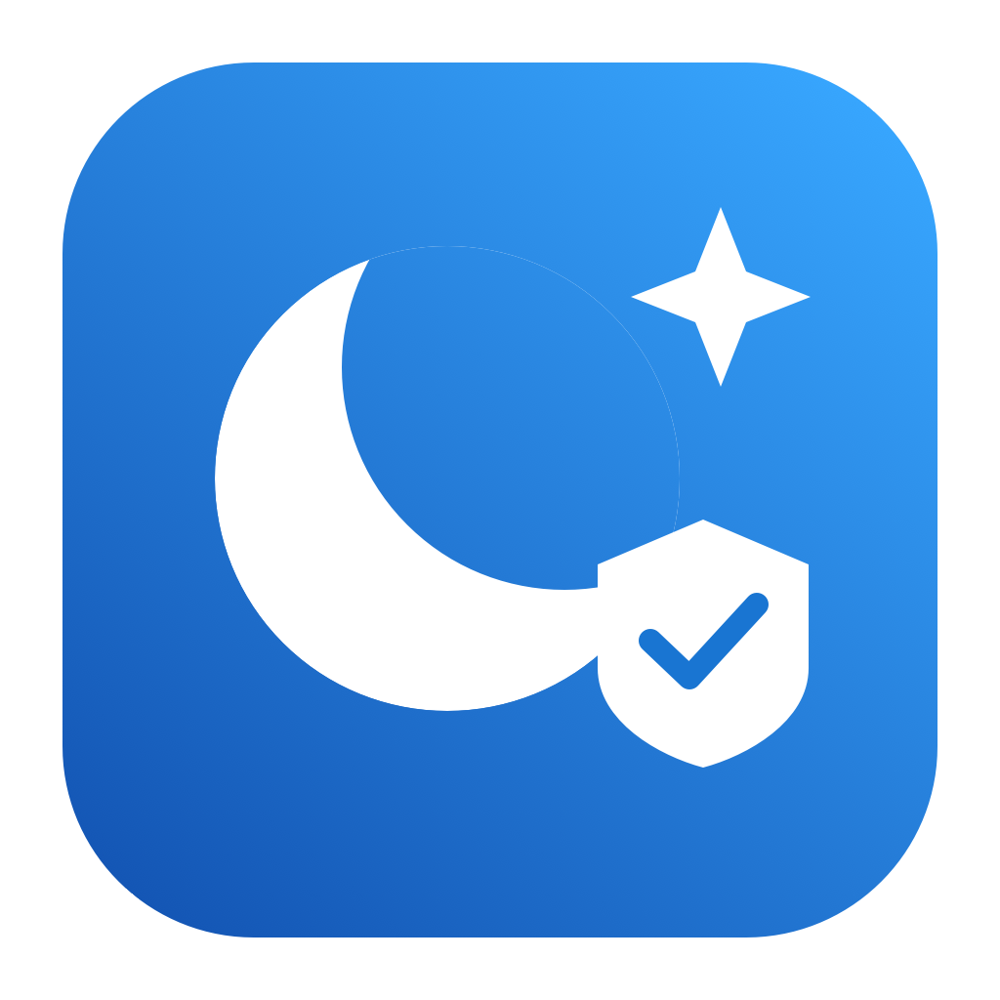
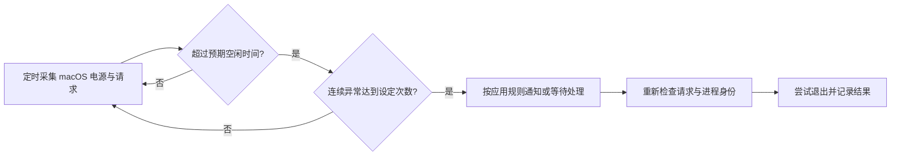

<div align="center">
  
  <h1>SleepGuard</h1>
  <p><strong>找出不肯睡的应用，让你的 Mac 按时休息。</strong></p>
  <p>A small native macOS menu bar app for sleep diagnostics, reminders and screen controls.</p>
  <p>
    <a href="https://github.com/bennie-asi/sleepguard/releases/latest"></a>
    <a href="https://github.com/bennie-asi/sleepguard/actions/workflows/build.yml"></a>
    <a href="LICENSE"></a>
    
    
  </p>
  <p><a href="#安装">安装</a> · <a href="#能做什么">功能</a> · <a href="#怎么判断休眠异常">工作原理</a> · <a href="#自己打包">自己打包</a> · <a href="CONTRIBUTING.md">参与开发</a></p>
</div>

你离开电脑很久，它却一直亮着。可能是远程桌面、音频应用或后台任务握着一个防休眠请求。

SleepGuard 把这些请求和责任应用放到菜单栏里。先观察，再通知；只有你明确配置了处理规则，才会自动尝试结束应用。要让 AI 任务继续跑，也可以一键把所有显示器变黑。

## 能做什么

| 功能 | 使用方式 |
| --- | --- |
| **休眠诊断** | 查看当前电源、空闲时间、系统休眠设置和应用防休眠请求 |
| **应用规则** | 按应用选择“通知”和“处理”；可以多选，都不选就是忽略 |
| **独立通知渠道** | macOS 系统通知、多 Telegram 渠道分别开关、测试和记录结果 |
| **暂停提醒与处理** | 暂停 30 分钟、1 小时或 2 小时，状态采集继续 |
| **手动结束应用** | 从当前请求中选择正常退出或强制结束，分别确认并再次核对身份 |
| **所有屏幕黑屏** | 纯黑遮罩覆盖内置和外接显示器，不锁屏；任意输入恢复 |
| **锁屏与快捷键** | 一键锁屏；行内录入全局快捷键，支持字母、数字与 F1–F19，检测冲突 |
| **事件历史** | 查看发现异常、渠道发送结果、暂停和应用处理记录 |
| **版本与更新** | 查看版本、一键更新，并配置自动检查或退出时安装 |

原生 SwiftUI 界面，Go 负责采集、规则、历史和后台监控。没有账号系统、云端仪表盘或遥测。只有启用 Telegram 时，通知内容会发送给 Telegram。

添加规则时可搜索应用，并按已启动、后台任务、未启动分类；方向键浏览、回车选择，手动填写作为单独入口。设置页显示当前连接的显示器，黑屏同时覆盖这些屏幕。

Webhook、飞书、Slack、邮件保留了添加渠道入口，**目前尚未实现发送**。每个已有渠道独立工作，一个失败不会阻止其他渠道发送。

## 安装

1. 到 [Releases](https://github.com/bennie-asi/sleepguard/releases/latest) 下载对应的 DMG：Apple Silicon 选 `arm64`，Intel 选 `x86_64`。
2. 打开 DMG，把 **SleepGuard.app 拖到 Applications**。
3. 从“应用程序”或 Spotlight 打开 SleepGuard，菜单栏会出现月亮图标。
4. 在“设置”里启动监控。需要登录后自动运行时，开启“登录时自动启动”；开关即时保存到 macOS 登录项。关闭管理窗口后仍会采集；退出 SleepGuard 会二次确认，并同时停止监控，保留登录启动设置。

请完成拖拽安装后再运行，不要直接从 DMG 或临时构建目录注册登录项。后台和图标都包含在 `.app` 中，不需要单独安装 Go。

从带更新能力的版本开始，后续版本可在“版本与更新”中点击**立即更新**，由应用直接下载、验证、安装并重新打开；无需再次处理 DMG。自动检查默认开启，自动下载并在退出时安装默认关闭。旧版首次安装带更新能力的版本仍需使用上述安装方式。

**当前没有 Developer ID 签名和 Apple 公证的构建**可能被 Gatekeeper 拦截。确认下载来源后，按 macOS 提示在“系统设置 → 隐私与安全性”中选择“仍要打开”。不需要关闭系统安全检查。工作流已支持接入 Developer ID 和公证，详见[发布指南](docs/releasing.md)。

最低编译目标为 macOS 13。实际验收平台与未覆盖项见 [验证记录](macos/VALIDATION.md)。

## 第一次使用

**先看状态。** “监控运行中”代表定时采集已启动。暂停后继续采样，页面显示恢复时间，可点击“立即恢复”；监控未运行时显示“启动监控”。异常应用会列在下方，不需要等到异常才看到运行状态。

**再开通知。** 系统通知打开时由 macOS 请求权限。Telegram 需要 Bot Token 和目标 Chat ID，Token 保存在登录钥匙串中，配置文件只存凭据服务名。可以添加多个电报渠道。

**最后配规则。** 添加规则时先搜索应用，按“已启动 / 后台任务 / 未启动”筛选，也可以手动填写 Bundle ID 或可执行文件路径。通知与处理互不依赖，允许只处理而不通知。自动结束总开关默认关闭；勾选处理规则后，还需要打开总开关。

| 通知 | 处理 | 效果 |
| :---: | :---: | --- |
| ✓ |  | 只发送提醒 |
|  | ✓ | 满足条件后尝试结束应用，不依赖通知发送结果 |
| ✓ | ✓ | 发送提醒，同时按等待时间进入处理流程 |
|  |  | 忽略这个应用 |

所有时间输入都使用统一的“数值 + 秒 / 分钟 / 小时”控件。

主应用直接持有包内 Go 监控子进程，不注册额外后台服务；“登录时自动启动”单独通过 `SMAppService.mainApp` 管理，并回读系统实际状态。开启后，登录 macOS 时自动启动菜单栏应用和监控；关闭开关不影响正在运行的监控。关闭管理窗口仍会监控，确认退出应用会同时停止监控，但保留下一次登录启动设置。首次使用以系统已有登录项状态为准；普通手动打开不会自动启动已停止的监控。

已移除旧服务迁移入口、LaunchAgent helper 和 CLI `service` 命令。需要命令行监控时使用前台 `sleepguard watch`；需要登录后自动运行时，使用设置中的“登录时自动启动”。主应用退出或意外终止后，管道关闭会让监控正常释放锁和数据库并退出。

## 怎么判断休眠异常



预期时间取系统休眠与显示器熄屏时间中的较大值，再加额外等待时间。唤醒后有独立宽限期。系统设置不允许自动休眠、显示器仍亮且没有明确阻止熄屏的请求，或只有 USB / 网络等内核请求时，会继续观察。

检测使用 IOKit 的结构化防休眠请求，并复核 PID、进程启动时间、当前用户和可执行文件。系统进程、SleepGuard 自身、其他用户进程及无法可靠归属的请求不会被结束。USB、外接存储和网络唤醒信息用于诊断，不会因此自动结束 `powerd`。

自动处理经过连续采样、处理等待和退出前等待，再次核对后发送 SIGTERM。只有显式开启“允许强制结束”，且等待后仍满足条件，才可能升级到 SIGKILL。手动正常退出使用 macOS 应用退出请求；后台任务使用 SIGTERM，**手动操作不会自动升级为强制结束**。

## 黑屏和锁屏有什么区别

黑屏是在当前所有屏幕上显示纯黑遮罩，不是关闭显示器电源，也不是系统休眠。期间临时保持 Mac 运行，暂停休眠提醒和自动处理；显示器接入或拔出会更新遮罩。任意按键、点击、滚轮或移动鼠标恢复，用户原有的暂停时间保留，异常计数重新开始。手动休眠、合盖等系统行为仍由 macOS 决定。

锁屏由系统登录框架执行，后台应用保留，之后是否休眠遵循系统设置。锁屏接口属于 macOS 私有 API；系统不支持时会显示错误，并提示使用 `⌃⌘Q`。

快捷键默认未设置。录入时会检查常用系统组合、应用内重复和 Carbon 注册失败。其他应用可能使用不同的快捷键机制，因此无法保证发现所有第三方冲突。

## 为什么钥匙串还可能询问一次

保存和读取凭据统一由 SleepGuard 的原生可执行文件完成，后台不再用通用 `security` 命令取出 Token，也不会弹密码窗口。需要访问旧凭据时，点击渠道的“测试通知”，在 **macOS 自带授权窗口选择“始终允许”**即可；没有额外的应用内授权页面。

如果钥匙串锁定、系统权限被撤销，后台会记录失败，不会反复打断你。临时签名的 App 重新编译后身份可能变化，需要重新授权一次；跨版本保持稳定身份需要同一个 Developer ID 证书。[Apple 钥匙串授权说明](https://support.apple.com/en-gb/guide/mac-help/kychn002/mac)。

## 自己打包

需要 macOS、Apple Command Line Tools（或 Xcode）、Go 1.27+、Swift 6 和 Python 3。脚本使用系统工具，不需要 Xcode 项目、Homebrew 打包工具或 Python 第三方依赖。

```sh
git clone https://github.com/bennie-asi/sleepguard.git
cd sleepguard
make test check check-ui
make dmg
```

产物位于 `dist/`：`.app`、DMG 和 SHA-256 校验文件。版本默认读取根目录 `VERSION`；也可通过 `VERSION=0.4.3`、`ARCH=arm64` 或 `ARCH=x86_64` 覆盖本地构建。完整原生运行验收建议在对应架构的 Mac 上进行。

构建不会覆盖仍在运行的 App 或内置后台。开发时可指定独立目录，例如 `APP_OUTPUT="$PWD/work/dev/SleepGuard.app" make dmg`，避免替换正在使用的应用文件。

### GitHub 一键构建

打开 **[Actions → Build DMG](https://github.com/bennie-asi/sleepguard/actions/workflows/build.yml) → Run workflow**，工作流按仓库中的 `VERSION` 在 Apple Silicon 和 Intel runner 上测试并打包，完成后从 Artifacts 下载。

推送 `vX.Y.Z` 标签时，工作流创建 GitHub Release，上传两种架构的 DMG 和校验文件。配置 Sparkle 签名 Secret 后会同时生成更新清单并发布；未配置时先生成草稿，可用本机钥匙串签署清单、上传后发布。Developer ID 和 Apple 公证可选。PR 和 `main` 推送只测试、构建，不发布 Release。配置步骤见[发布指南](docs/releasing.md)。

### CLI 仍然可用

```sh
make build
bin/sleepguard status
bin/sleepguard version --json
bin/sleepguard status --json
bin/sleepguard config example
bin/sleepguard watch --dry-run --once
bin/sleepguard history --limit 30
```

`status` 只查询一次；`watch` 按配置间隔循环。命令详情用 `bin/sleepguard --help`。独立 CLI 可从环境变量读取 Telegram Token；钥匙串渠道通过 App bundle 内的原生通知辅助进程发送。

## 数据和日志

| 内容 | 默认位置 |
| --- | --- |
| 配置 | `~/.config/sleepguard/config.toml` |
| 事件数据库 | `~/Library/Application Support/sleepguard/state.db` |
| 后台运行日志 | `~/Library/Application Support/sleepguard/agent.log` |
| 快捷键 | SleepGuard 的 macOS 用户偏好设置 |
| Token | macOS 登录钥匙串 |

历史页可以打开日志或在 Finder 中定位文件。数据库与配置使用当前用户权限；历史默认保留 30 天。配置、凭据和运行数据不包含在发布包里。

## 参与开发

欢迎提交问题、改进界面和接入新的通知渠道。先看 [CONTRIBUTING.md](CONTRIBUTING.md)、[架构说明](docs/architecture.md)和[验证记录](macos/VALIDATION.md)。

如果这个小工具帮你找到了不肯睡的应用，欢迎点个 Star，或者在 Issue 中分享遇到的请求类型。

## License

[MIT](LICENSE) © Bennie。依赖与格式参考见 [THIRD_PARTY.md](THIRD_PARTY.md)。
